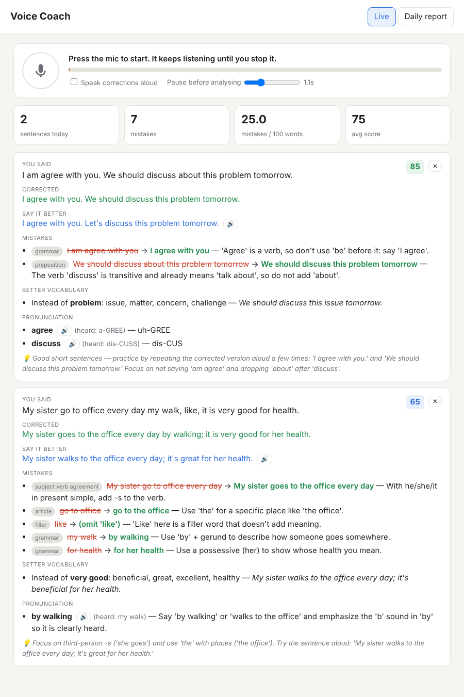
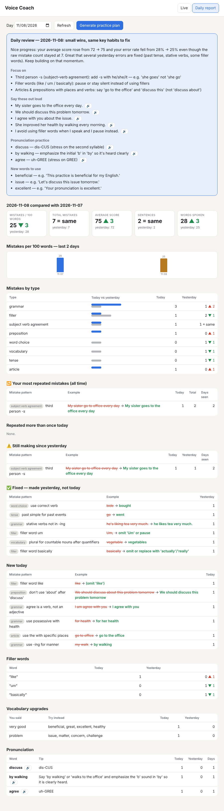

# Voice Coach — always-listening speaking coach

| Live feedback | Daily report |
|---|---|
|  |  |

Keep the page open, press the mic once, and just talk. Every time you finish a sentence, the coach:

1. **Transcribes exactly what you said**, mistakes and filler words included (`gpt-4o-transcribe`).
2. **Corrects your grammar**, explains each mistake in one line, and shows a **more natural way to say it**.
3. **Suggests stronger vocabulary** for plain or overused words (good, nice, thing…).
4. **Checks pronunciation** by listening to the actual audio (`gpt-4o-audio-preview`). It also flags words the transcriber misheard, which usually means they were mispronounced. Press 🔊 to hear the correct pronunciation.
5. **Tracks repeated mistakes.** Each mistake gets a stable pattern name (e.g. "third person -s (he go -> he goes)"), so the same mistake is counted again each time you make it. Repeats get a red "repeated ×N" chip.

The **Daily report** tab compares today with yesterday:
mistakes per 100 words, score, mistakes by type, your **most repeated mistakes of all time**, mistakes you are
**still making**, mistakes you **fixed**, new mistakes, filler words (um, like, basically…), overused words,
vocabulary upgrades, pronunciation words, and a 14-day trend. **Generate practice plan** writes drill sentences
built from your own repeated mistakes, plus words to practise pronouncing and new words to start using.

## How it teaches (methods that are known to work)
| Method | Where in the app |
|---|---|
| **You say the correction, not just read it.** Learners who are prompted to self-correct fix more than those who are just shown the answer. | **🎙 Say it** on every live card checks you as you repeat the natural version |
| **Spaced repetition** (Anki / Duolingo style, 1 → 3 → 7 → 14 → 30 days) | **Practice** tab: your own mistakes come back as flashcards. A wrong answer brings the card back tomorrow |
| **Retrieval, not re-reading**: you see what you said wrong and recall the fix before seeing it | Practice cards hide the answer until you try (or press *Show answer*) |
| **Shadowing**: listen, then repeat | 🔊 Listen + 🎙 Say it; the answer is read aloud after two misses |
| **Focus on a few errors at a time** | "🎯 Watch out today" on Live; **top 3 weak spots** on Progress |
| **Help at the moment you need it** (while speaking) | Live panel: your words appear as you talk (browser speech recognition, Chrome/Edge). On every short pause it shows "fix as you go" (e.g. *go → went*) and 3 ways to finish your sentence correctly |
| **Model sentences to copy** (suggested next sentences) | "💬 You could say next" on Live: 2–3 correct sentences that continue your topic and use your weak rules correctly. Press 🎙 to say one. No extra AI call |
| **See the whole thing, then the model version** | **Conversations** tab: full text of what you said, the corrected version and the better way, sentence by sentence too, plus ✨ *Polish* for one natural retelling. All of it is saved |
| **Fluency, not only accuracy** | words per minute (natural: 120–160), fillers per 100 words (aim < 2), share of clean sentences |

Checking an attempt costs one transcription call and no AI analysis. Repeating sentences is cheap.

## Run it

```bash
cd voice-coach
pip install -r requirements.txt
cp .env.example .env        # then put your OPENAI_API_KEY in .env
uvicorn app.main:app --port 8000
```

Open **http://localhost:8000** in Chrome or Edge, press the mic, and allow microphone access.
Browsers only allow the mic on `localhost` or HTTPS. To use it from your phone, serve it over HTTPS.

## How "always listening" works
- The browser keeps the mic open and runs voice-activity detection that adapts to the noise in your room. The
  yellow mark on the level bar is the speaking threshold.
- When you pause (default 1.1 s, adjustable), that sentence is sent as a 16 kHz WAV. Silence is never uploaded.
- With **Speak corrections aloud** on, the coach reads the better version back to you. It mutes the mic while it
  speaks, so it doesn't coach its own voice.
- Delete a card with ✕ if it caught someone else (TV, another person). It is then removed from your stats.
- History is stored locally in `data/coach.db` (SQLite). Your API key stays on the server.

## Settings (`.env`)
| Variable | Default | Purpose |
|---|---|---|
| `OPENAI_API_KEY` | – | set this **or** `OPENROUTER_API_KEY` |
| `OPENROUTER_API_KEY` | – | use OpenRouter instead; models default to `google/gemini-2.5-flash` (transcription + pronunciation, via audio-input chat) and `openai/gpt-5-mini` (coaching) |
| `TRANSCRIBE_MODEL` | `gpt-4o-transcribe` | speech to text |
| `COACH_MODEL` | `gpt-5-mini` | grammar, phrasing, vocabulary, daily plan (needs structured outputs) |
| `PRONUNCIATION_MODEL` | `gpt-4o-audio-preview` | audio pronunciation check; leave empty to turn it off and save cost |
| `LIVE_MODEL` | `google/gemini-2.5-flash-lite` (OpenRouter) / `gpt-4.1-nano` | fast model for **live suggestions while you speak** (fixes so far + ways to finish the sentence, about 0.7 s, about $0.0001 per call). `openai/gpt-4.1-mini` is a bit more natural but slower. Leave empty to turn it off |
| `TARGET_LANGUAGE` | `English` | language you're practising |

## Cost
Each sentence costs one transcription call, one text call, and, if enabled, one audio call. For long
always-on sessions, turn the pronunciation pass off or use cheaper models.

## Tests
`python tests/test_pipeline.py` runs the whole server pipeline and the day-over-day report with OpenAI mocked out.
